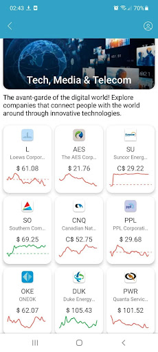

# Thematic lists

The Discover tab allows a user to access the Thematic lists section. It contains categories which help a user to choose an instrument for investing. The following categories are available for viewing:

.png>)

Tap the preferred category to see the list of symbols that refers to it thematically.

Each thematic list contains the cards with the following information:

* Symbol name;
* Description;
* Last price;
* Mini line chart.

.png>)
